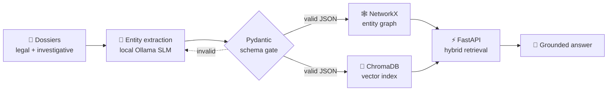
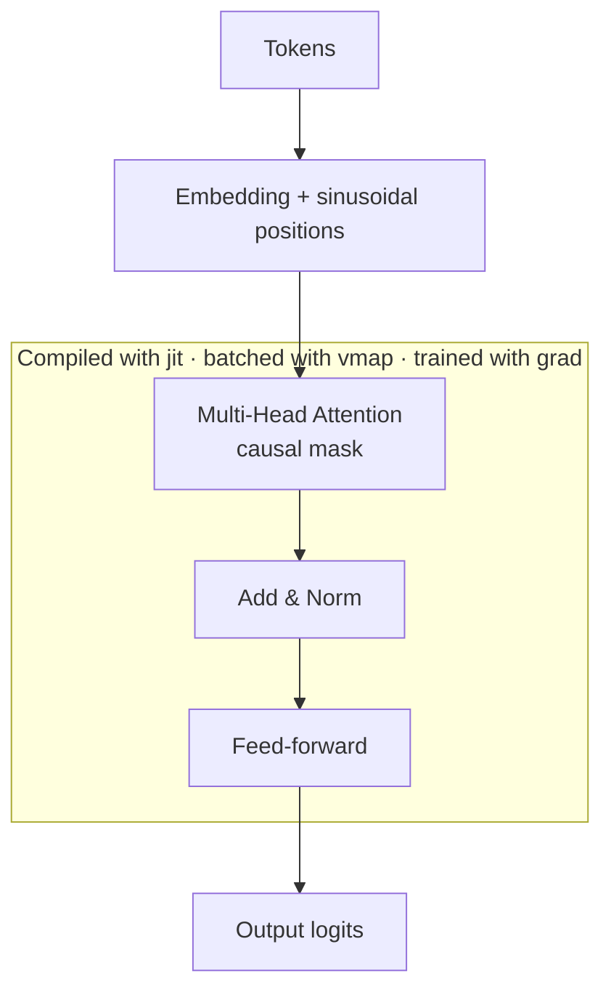

<!-- Animated waving header -->

  

<!-- Typing animation -->

  

  
  
  

  
  
  

---

## 🧭 About Me

> I like understanding how things work underneath the framework.

I've written a Transformer in raw JAX, wired up a multi-node MPI cluster by hand, and built a GraphRAG platform that runs air-gapped on local models.

| | |
|---|---|
| 🔭 **Focus** | LLM systems, RAG, attention, accelerated compute |
| 🛠️ **Style** | First-principles builds, strict schemas, reproducible infra |
| 🌱 **Looking for** | Internships and junior roles with real AI/ML work, ideally at early-stage startups |
| 🐧 **Daily driver** | Linux + VS Code |

---

## 🚀 Featured Projects

<table>
<tr>
<td width="50%" valign="top">

### 🕵️ S.P.A.R.K.
**Air-gapped investigative intelligence platform**

Offline GraphRAG over unstructured legal and investigative dossiers. Entities live in NetworkX graphs beside ChromaDB vector indices, with strict Pydantic schemas over local Ollama output.

`FastAPI` `PostgreSQL` `ChromaDB` `Ollama` `NetworkX`

</td>
<td width="50%" valign="top">

### 🧠 Transformer from Scratch
**Custom attention engine in JAX**

Seq2seq Transformer from math, with no prebuilt model layers. Custom multi-head attention, positional encodings and causal masks, compiled with `jit` and `vmap`.

`JAX` `Flax` `XLA` `Python`

</td>
</tr>
<tr>
<td width="50%" valign="top">

### 🖧 Distributed HPC Cluster
**Multi-node compute on Rocky Linux**

Static private routing, passwordless SSH and shared NFS. Parallel matrix multiplication in C with OpenMPI and latency profiling.

`Rocky Linux` `OpenMPI` `C` `Bash`

</td>
<td width="50%" valign="top">

### 🛡️ AirSCA
**Dependency vulnerability analysis API**

Parses SBOM data and maps the blast radius of vulnerable transitive dependencies with recursive SQL CTEs.

`FastAPI` `PostgreSQL` `Asyncio`

</td>
</tr>
</table>

<b>🔍 How S.P.A.R.K. works (click to expand)</b>

 

- **Problem:** manual cross-referencing of dossiers meant multi-hour lookups.
- **Resilience:** strict Pydantic schemas over Ollama streams block non-deterministic JSON failures.
- **Constraint:** everything runs offline, with no external API calls.

<b>⚙️ How the JAX Transformer is built (click to expand)</b>

 

---

## 🧰 Tech Stack

  

| Area | Tools |
|---|---|
| **Languages** | Python (Asyncio, Pydantic), C++17/20, C, SQL, Bash |
| **AI / ML** | JAX/Flax, PyTorch, scikit-learn, PEFT (LoRA), Ollama, ChromaDB, pgvector |
| **Backend & Data** | FastAPI, REST, PostgreSQL (B-Tree indexing, CTEs), Firebase Functions |
| **Infra** | Linux (Rocky, Ubuntu), Docker, OpenMPI, AWS (EC2), OCI, Git |

---

## 💼 Experience

**Freelance Software Engineer, Orange Elixirs** · *Dec 2023 – Mar 2024*

- Owned cloud and backend delivery for a subscription video-streaming mobile app, from client requirements to a serverless MVP.
- Built idempotent Firebase Cloud Functions to validate Google Play billing webhooks without race conditions.
- Secured media delivery with token-authenticated Bunny.net CDN endpoints.

---

## 🎓 Education & Certifications

**B.Tech, Computer Science & Engineering (Software Engineering)** · Ajeenkya DY Patil University, Pune · 2023 – 2027

  
  
  
  

---

## 🤝 Let's Connect

> [!TIP]
> I'm open to internships and junior ML/AI engineering roles. If you're building something where the models, the retrieval and the infrastructure all matter, let's talk.

📫 **dev.piyush195@gmail.com** · [LinkedIn](https://linkedin.com/in/piyushbanarjee)

<i>"If I can't build it from scratch, I don't understand it yet."</i>

  

